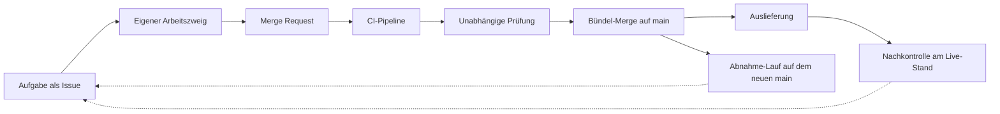

# So ist das Projekt entstanden: Arbeiten mit vielen KI-Agenten

Diese Seite ist für Menschen, die selbst mit KI-Agenten entwickeln wollen. Sie beschreibt, wie ein Mensch mit vielen
gleichzeitig arbeitenden Coding-Agenten während der KI Challenge (laut Veranstalter knapp 24 Stunden) den größten Teil dieses Repos
gebaut hat: welche Rollen es gab, welchen Weg jede Änderung genommen hat, welche Regeln getragen haben und was
schiefging. Was schon vorher entstanden ist, steht in [`docs/abgabe/herkunft.md`](../abgabe/herkunft.md). Es ist eine Werkstattbeschreibung, keine
Erfolgsgeschichte.

## Die Idee in drei Sätzen

Ein Mensch entscheidet, was gebaut wird, und gibt Fachliches mit seinem Namen frei. Eine führende Sitzung (eine
KI-Sitzung, die nur ordnet) verteilt die Arbeit, bündelt die fertigen Änderungen und bringt sie auf den Hauptzweig.
Viele Arbeits-Sitzungen bauen gleichzeitig, jede in ihrem eigenen Bereich, und unabhängige Prüf-Sitzungen lesen jede
Änderung gegen, bevor sie zählt.

Den Code hat das Team mit dem Entwicklungswerkzeug Claude Code (Claude Opus 5.5) geschrieben
([`abgabe/modelle.md`](../../abgabe/modelle.md)). Eine Sitzung ist eine laufende Instanz dieses Werkzeugs mit eigenem
Auftrag. Die Commit-Zeilen `Co-Authored-By` auf `main` nennen 858-mal Claude Opus 5.5 und 4-mal Claude Fable 5.1
(`git log --format=%B bcabeab | grep -c`, je Modellname). Geprüft hat nicht nur dasselbe Modell: Der Abnahme-Prozess
wurde von Fable 5.1 und von Astra (Codex) unabhängig gegengelesen ([`PROZESS.md`](../abnahme/PROZESS.md)), und
Prüf-Sitzungen haben Codex als zweiten Prüfer neben Opus eingesetzt. Jede Arbeits-Sitzung kann selbst Unter-Agenten in Wellen starten; die Grundeinstellung steht in
[`CLAUDE.md`](../../CLAUDE.md), Abschnitt „Session Config“ (4 Wellen, bis zu 6 Agenten je Welle). Im Betrieb setzt das
Entwicklungswerkzeug keine Änderung um: Das machen die eigenen Agenten der Anwendung, und auch dort rechnet kein
Sprachmodell eine Zahl.

## Zeitleiste

| Zeitpunkt | Was geschah |
|---|---|
| 03.11. 07:47 | Erster Commit im Repo (Use-Case-Datei der Veranstalter). |
| 05.11. 10:36 | Der Mensch legt den vollen Fokus auf die Challenge. |
| 05.11. 12:10 | Wahl von Use Case 3 als Commit `e935ede` „Select use case uc3“; bis 12:20 Planung in sieben großen Arbeitspaketen (Epics). |
| 05.11. 12:51 | Baustart. Ab 13:12 bauen sechs Arbeits-Sitzungen gleichzeitig, jede in einem eigenen Arbeitsbaum. |
| 05.11. 13:54 | Entscheid: Änderungen werden gebündelt gemergt („Züge“) statt einzeln. |
| 05.11. gegen 14:35 | Die Startseite ist öffentlich erreichbar. |
| 05.11. 15:36 | Drei neue Bereiche: Präsentation, Oberfläche von Use Case 3, unabhängige Abnahme. |
| 05.11. nach 17:40 | Der Mensch findet die Live-Seite „überladen“. Folge: eine Oberflächen-Regie, die je Seite festlegt, was bleibt und was wegfällt. |
| 05.11. 18:50 | Engpass war die eine Prüf-Bank, nicht die CI: eine zweite Prüf-Bank kommt dazu. |
| 05.11. 23:26 bis 23:46 | Die Generalprobe der Vorführung scheitert beim Schritt „festschreiben“; mit Fix um 23:46 bestanden. |
| 06.11. ab 00:35 | Der Zweitrechner fällt aus, Prüfungen ziehen auf den CI-Server um. Dort ist der Weg der Jury von 03:04 bis 03:59 auf einem frischen Klon bestanden. |
| 06.11. ab 05:37 | Schlusslauf der Abnahme auf dem festen Merge-Stopp-Stand, schwere Prüfungen von 05:38 bis 06:07 ([Beleg](../abnahme/schlusslauf-2026-11-06.md)). Ab 06:28 Baustopp: nur noch Abbau und kleine Korrekturen bis zur Abgabe. |

Quelle: Die Zeitpunkte mit Commit (03.11. 07:47 und 05.11. 12:10) sind mit `git log` nachprüfbar (Wiener Zeit). Alle
anderen stammen aus dem Arbeitsprotokoll der führenden Sitzung, Stand 06.11.2026 06:34; dieses Protokoll liegt nicht
im Repo. Was nach 06:34 geschah, steht hier nicht.

## Die Rollen

| Rolle | Aufgabe | Was sie nicht darf | Wo es steht |
|---|---|---|---|
| Mensch | Entscheidet Use Case, Vorrang und Online-Gang; gibt Regeln und Ergebnisse mit Vor- und Nachnamen frei | Eine Freigabe ohne seinen Namen gilt nicht; „Team“ oder „Admin“ als Name werden abgelehnt | [`CLAUDE.md`](../../CLAUDE.md), [`abgabe/protokoll.md`](../../abgabe/protokoll.md) |
| Führende Sitzung | Teilt Bereiche zu, setzt Fristen, bündelt geprüfte Änderungen zu Zügen, mergt, startet die Auslieferung | Gibt nichts Fachliches selbst frei. Vier Freigaben, die sie am 05.11. im Auftrag eingegeben hat, hat der Mensch am selben Abend selbst bestätigt | [`abgabe/protokoll.md`](../../abgabe/protokoll.md) |
| Arbeits-Sitzungen | Bauen in einem eigenen Arbeitsbaum, nur in ihrem Bereich, und öffnen einen Merge Request | Mergen nicht selbst; schreiben nicht in fremde Bereiche; ändern `web/package.json` und `pnpm-lock.yaml` nicht (das darf nur die Plattform) | [`CLAUDE.md`](../../CLAUDE.md), [`docs/entwicklung.md`](../entwicklung.md) |
| Prüf-Sitzungen (Prüf-Bank) | Lesen jeden Merge Request gegen und geben ein Urteil an die führende Sitzung | Schreiben keinen Code; den Fix macht der Bereich, dem der Code gehört | [`docs/abnahme/PROZESS.md`](../abnahme/PROZESS.md), Zuständigkeiten |
| Abnahme-Sitzung | Misst jedes Abnahmekriterium bei jedem neuen Stand des Hauptzweigs, mit Befehl, Ausgabe und Commit | Schreibt nur Protokolle und Skripte, die lesen und messen; ein Urteil eines Mess-Agenten gilt nur als Vorschlag | [`docs/abnahme/README.md`](../abnahme/README.md) |
| Oberflächen-Regie | Legt je Seite fest, was bleibt und was wegfällt; Sichtbares geht vor dem Merge an ihr vorbei | Besitzt keine Seiten-Dateien; umsetzen tun die Bereiche, denen die Seiten laut Besitz-Tabelle gehören | [`docs/ux/regie.md`](../ux/regie.md), [`CLAUDE.md`](../../CLAUDE.md) |

## Der Weg einer Änderung

Das Bild zeigt den Weg von der Aufgabe bis zur Kontrolle am laufenden System; die gestrichelten Pfeile heißen: Was die
Kontrolle findet, wird wieder eine Aufgabe.

| Schritt | Was dort geprüft wird |
|---|---|
| Aufgabe als Issue | Ein Issue ist eine Aufgabe in GitLab. Ihre Abnahmekriterien stehen in der Beschreibung, jedes mit einer festen Kennung, damit eine Messung genau ein Kriterium belegt ([`PROZESS.md`](../abnahme/PROZESS.md)). |
| Eigener Arbeitszweig | Jede Sitzung hat einen eigenen Arbeitsbaum und Zweig ([`entwicklung.md`](../entwicklung.md)). Vor jedem Commit sucht `gitleaks` nach Zugangsdaten und blockiert ([`scripts/hooks/pre-commit`](../../scripts/hooks/pre-commit)). |
| Merge Request | Ein Merge Request ist der Antrag, eine Änderung in den Hauptzweig `main` zu übernehmen. Nur so kommt Code auf `main`. Ein Fix zu einem Kriterium nennt dessen Kennung (`Abnahme: <id>`). |
| CI-Pipeline | Die CI ist die automatische Prüfstraße in GitLab, sie läuft bei jedem Merge Request ohne Modellschlüssel (`LLM_PROVIDER=mock`). Jobs in [`.gitlab-ci.yml`](../../.gitlab-ci.yml): `gitleaks` (Schlüsselsuche über die ganze Historie), `python` (ruff, mypy, pytest ohne echte Daten, Abnahme-Prüfsätze ohne Datenbank, Abgabe-Skripte), `web` (TypeScript-Prüfung, ESLint, Vitest), `web-build` (Produktions-Build), `playwright` (Browser-Tests mit Anti-Schablonen-Gate auf einer Testdatenbank aus erfundenen Daten; jede Seite muss antworten), `deploy-check` (nur bei Änderungen an der Auslieferung: Skripte, Webserver-Konfiguration, feste Regeln für die Container). |
| Unabhängige Prüfung | Eine Prüf-Sitzung, die den Code nicht geschrieben hat, liest die Änderung gegen und gibt ein Urteil. Ein grüner Merge Request allein ist kein Beleg ([`PROZESS.md`](../abnahme/PROZESS.md), Definition of Done). |
| Bündel-Merge auf main | Die führende Sitzung fasst mehrere geprüfte Merge Requests in einen Zweig `zug/…` zusammen; der Zug läuft noch einmal durch die CI und wird dann als ein Merge übernommen. |
| Auslieferung | Nur der manuelle Job `deploy` in einer Pipeline auf `main`, und erst nach grünen Prüf- und Test-Jobs. Er ruft `scripts/deploy.sh up` und danach `scripts/deploy.sh pruefen` auf. |
| Nachkontrolle am Live-Stand | Nach der Auslieferung prüft jemand die öffentliche Seite selbst, nicht nur die Meldung „fertig“. Die Oberflächen-Regie hat ihre Bestandsaufnahme an den Live-Seiten gemacht ([`regie.md`](../ux/regie.md)). |
| Abnahme-Lauf | Bei jedem neuen Stand von `main` misst die Abnahme alle Kriterien neu; schwere Prüfungen mit Datenbank laufen auf einem eigenen Prüfrechner gegen eine eigene Prüf-Datenbank ([`PROZESS.md`](../abnahme/PROZESS.md), Rhythmus). |

## Die Regeln, die getragen haben

| Regel | Warum | Wo sie steht |
|---|---|---|
| Jede Datei gehört genau einem Bereich und damit einer Sitzung | Zwei Sitzungen, die dieselbe Datei ändern, überschreiben sich oder erzeugen Konflikte, die keiner auflöst | [`CLAUDE.md`](../../CLAUDE.md) (Struktur und Lanes), [`entwicklung.md`](../entwicklung.md) (Arbeitsteilung) |
| Gemeinsame Dateien hat einer: `web/package.json` und `pnpm-lock.yaml` nur die Plattform; das Python-Lockfile erneuert der Bereich, der zuletzt mergt, nie von Hand | Lockfiles sind die häufigste Konfliktquelle, wenn viele gleichzeitig Pakete brauchen | [`CLAUDE.md`](../../CLAUDE.md) |
| Nach dem Merge-Stopp läuft die Schlussprüfung auf genau einem festen Stand | Eine Prüfung gilt nur für den Stand, auf dem sie lief | [`SCHLUSSLAUF.md`](../abnahme/SCHLUSSLAUF.md), [`PROZESS.md`](../abnahme/PROZESS.md) |
| Jede Zahl hat einen Beleg: aus welcher Lieferung und mit welcher Abfrage sie gerechnet wurde | Eine Zahl ohne Herkunft kann niemand nachprüfen | [`README.md`](../../README.md) (Lösung und Ansatz), [`sprache.md`](../sprache.md) |
| Zahlen rechnet nur der Code, nie ein Sprachmodell | Zwei Läufe mit denselben Daten und Regeln müssen dieselben Zahlen liefern | [`CLAUDE.md`](../../CLAUDE.md) (Leitlinien), [`abgabe/modelle.md`](../../abgabe/modelle.md) |
| Ein Mensch gibt jede Regel- und Codeänderung mit Vor- und Nachnamen frei, als Commit-Zeile `Freigegeben-von` | Verantwortung braucht einen Namen, nicht eine Rolle | [`CLAUDE.md`](../../CLAUDE.md), [`loesung-und-ansatz.md`](loesung-und-ansatz.md#freigabe-durch-einen-menschen) (Freigabe durch einen Menschen) |
| Eine zweite Sitzung prüft vor dem Merge; ein geschlossenes Issue, ein grüner Merge Request oder ein Haken allein sind kein Beleg | Wer selbst gebaut hat, übersieht die eigenen Annahmen | [`PROZESS.md`](../abnahme/PROZESS.md) (Zuständigkeiten, Definition of Done) |
| Nachkontrolle am Live-Stand statt Vertrauen auf „fertig“ | Eine Meldung „fertig“ belegt nicht, dass die Seite online so aussieht | [`.gitlab-ci.yml`](../../.gitlab-ci.yml) (Job `deploy` mit `pruefen`), [`regie.md`](../ux/regie.md) |
| Einfache Sprache ist ein Prüfkriterium: ein Wort für eine Sache, Fachwort mit Erklärung, keine Gedankenstriche | Die Jury und Fachfremde sollen jeden Satz ohne Rückfrage verstehen | [`sprache.md`](../sprache.md), [`design.md`](../design.md) (Anti-Schablonen-Gate) |
| Keine Zugangsdaten im Repo, geprüft vor jedem Commit und in der CI | Das Repo ist öffentlich | [`scripts/hooks/pre-commit`](../../scripts/hooks/pre-commit), Job `gitleaks` |

## Zahlen zur Arbeitsweise

| Was | Zahl | Quelle |
|---|---|---|
| Aufgaben (Issues) | 58 von 202 sind erledigt | GitLab-Projekt, gemessen 06.11.2026 06:34 |
| Merge Requests | 323, davon 298 gemergt | GitLab-Projekt, gemessen 06.11.2026 06:34 |
| Commits, erreichbar von `main` | 1.395 | `git rev-list --count 48761dcc` (Stand `main` vom 06.11.2026 06:37) |
| Merges direkt auf der Linie von `main` | 110, davon 85 aus Zug-Zweigen `zug/…` | `git log --first-parent --merges --format=%s 48761dcc`, gezählt alle Zeilen und die mit `'zug/` |
| Commits mit der Zeile `Freigegeben-von` | 29 | `git log --format=%B 48761dcc \| grep -c '^Freigegeben-von'` |

Mehr Zahlen zum Projekt stehen in [`zahlen.md`](zahlen.md).

## Was schiefging und was das Team daraus gelernt hat

| Befund | Ursache | Gegenmaßnahme | Beleg |
|---|---|---|---|
| Die Oberfläche war trotz grüner Prüfungen überladen: Jede Seite erklärte sich selbst, bevor sie etwas zeigte, und die eine Sache, die man tun soll, ging unter. | Die automatischen Prüfungen messen Muster und Barrierefreiheit, nicht, ob man eine Seite in fünf Sekunden versteht. | Eine Oberflächen-Regie mit Maßstab je Seite: Fünf-Sekunden-Test, eine Hauptaussage und eine Hauptaktion je Bildschirm, kein totes Bedienelement. | [`docs/ux/regie.md`](../ux/regie.md) |
| Die Abnahme meldete zu früh „bestanden“: Ein Beleg blieb nach jedem Merge gültig, und Urteile von Mess-Agenten zählten ohne Nachmessung (etwa ein Kriterium, bei dem zwei Teile gar nicht gemessen waren). | Der erste Entwurf prüfte nur, ob der Text des Kriteriums gleich blieb, nicht den Stand des Codes; Agenten urteilten selbst. | Ein Beleg gilt nur, solange sich die Pfade des Bereichs nicht geändert haben, sonst „veraltet“. Agenten liefern nur Vorschläge, „bestanden“ zählt nur aus einem Lauf oder vom Prüfer. Gefunden haben das zwei unabhängige Reviews. | [`PROZESS.md`](../abnahme/PROZESS.md), [`review-fable-2026-11-05.md`](../abnahme/review-fable-2026-11-05.md), [`review-astra-2026-11-05.md`](../abnahme/review-astra-2026-11-05.md) |
| Am 05.11. waren über ein Dutzend gemeldete Befunde falsch. | Der Befundtext war älter als der Stand, gegen den gemessen wurde. | Bei jedem unerwarteten „nicht bestanden“ erst Befehl und Ausgabe lesen, dann gegen `main` nachsehen, dann erst an den Bereich melden. | [`SCHLUSSLAUF.md`](../abnahme/SCHLUSSLAUF.md), Abschnitt „Fallen“ |
| Der Weg der Jury (`uv run uc3 lauf --alle`) hing auf einer frisch geladenen Datenbank ab dem dritten Monat. | Veraltete Statistik des Datenbank-Planers auf der frisch geladenen Datenbank. | Gefunden hat es die unabhängige Abnahme, die auf einer frischen Datenbank misst. Fix in !58, nachgemessen: 24 von 24 Monaten in 419 Sekunden, bitgleich. | [`docs/abnahme/66.md`](../abnahme/66.md) |
| In der Generalprobe brach „festschreiben“ die Datenbank der Vorführ-Instanz ab. | Postgres lief als erster Prozess im Container und erbte einen verwaisten Prüfprozess; dessen Fehlercode hielt Postgres für einen Absturz. | `init: true` im Container, dazu eine feste Regel, die der CI-Job `deploy-check` prüft. Die Generalprobe danach war bestanden. | [`docker-compose.vorfuehrung.yml`](../../deploy/docker-compose.vorfuehrung.yml), [`vorfuehrung-invarianten.jq`](../../deploy/vorfuehrung-invarianten.jq), [`docs/betrieb/vorfuehrung.md`](../betrieb/vorfuehrung.md) |
| Der Zweitrechner war ab 06.11. 00:35 nicht mehr erreichbar. | Ursache in der Nacht nicht messbar. | Ein vorbereiteter Ersatzrechner über eine einzige Einstellungsdatei, mit festen Grenzen (eigener Ordner, Kerne und Speicher begrenzt, danach restlos abräumen). | [`SCHLUSSLAUF.md`](../abnahme/SCHLUSSLAUF.md), Abschnitt „Ersatzrechner“; [`backup-video.md`](../praesentation/backup-video.md) |

## Wenn du es selbst so machen willst

1. Schreib vor dem Start eine Tabelle ins Repo, welcher Bereich welche Dateien besitzt, und gib Lockfiles genau einem
   Besitzer (Regeln, erste und zweite Zeile).
2. Lass Arbeits-Sitzungen nie selbst mergen. Eine Stelle mergt, und sie bündelt geprüfte Änderungen zu Zügen, sobald
   viele gleichzeitig fertig werden (Rollen, Zeitleiste 13:54).
3. Setz von Anfang an eine zweite Prüf-Bank, wenn mehr als eine Handvoll Sitzungen baut; der Engpass war dort, nicht in
   der CI (Zeitleiste 18:50).
4. Werte ein Urteil eines Agenten als Vorschlag. „Bestanden“ zählt erst mit Befehl, Ausgabe und Commit auf dem
   aktuellen Stand (Was schiefging, zweite Zeile).
5. Lies vor jeder Meldung eines Befunds Befehl und Ausgabe gegen den aktuellen Stand nach (Was schiefging, dritte Zeile).
6. Prüf den Weg, den Außenstehende gehen, auf einer frischen Umgebung und nicht auf deiner Arbeits-Datenbank (Was
   schiefging, vierte Zeile).
7. Spiel die Vorführung einmal ganz durch, bevor es ernst wird, und halte für jeden Rechner einen Ersatz bereit (Was
   schiefging, fünfte und sechste Zeile).
8. Lass früh einen Menschen oder eine Regie die Live-Seite mit dem Fünf-Sekunden-Test ansehen; grüne Prüfungen sagen
   nichts über Verständlichkeit (Was schiefging, erste Zeile).

## Weiter lesen

- [Übersicht dieses Ordners](README.md)
- [Zahlen zum Projekt](zahlen.md)
- [Architektur](architektur.md)
- [README des Repos](../../README.md)
- [Entwicklung und Arbeitsteilung](../entwicklung.md)
- [Abnahme-Prozess](../abnahme/PROZESS.md) und [Schlusslauf](../abnahme/SCHLUSSLAUF.md)
- [UI-Regie](../ux/regie.md) und [Sprache](../sprache.md)
- [Herkunft und Rechte](../abgabe/herkunft.md)
