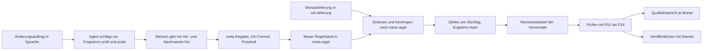

# Architektur und Software-Stack

Diese Seite ist für Technikerinnen und Techniker, die verstehen wollen, wie das System gebaut ist und warum.
Danach weiß man, welche Teile es gibt, mit welcher Technik sie laufen, wo ein Sprachmodell mitarbeitet und wo
nicht, und wie ein Mensch eine Änderung freigibt. Jede Angabe nennt die Datei, in der sie steht.

## Das System in einem Absatz

Das Repo ist eine Plattform mit drei Räumen (UC1, UC2, UC3) und einem gemeinsamen Einstieg (UC4). Bewertet wird
UC3, der StatAgent: Er liest die Monatslieferungen der Sozialversicherung ein, bereinigt sie nach Regeln aus der
Datenbank, zählt die Beschäftigungsverhältnisse am Stichtag, prüft jede Lieferung und schreibt je Monat einen
Qualitätsbericht. Python und SQL rechnen, eine Weboberfläche in Next.js zeigt die Ergebnisse mit Beleg, und eigene
Agenten setzen Änderungsaufträge als Vorschläge um, die ein Mensch freigibt.

Die drei Grundsätze stehen in der Langfassung zu „Lösung und Ansatz“ ([`loesung-und-ansatz.md`](loesung-und-ansatz.md)) so:

> **Die KI schreibt Code und Texte, das Programm rechnet.** Jede Zahl kommt aus der Datenbank und trägt ihren
> Beleg. Jede Änderung an Regeln oder Code gibt ein Mensch mit Vor- und Nachnamen frei.

Der Kernsatz in [`docs/sprache.md`](../sprache.md) fasst dasselbe kürzer: „Die KI schreibt Code und Regeln,
gerechnet wird ohne KI, ein Mensch gibt mit Namen frei.“

## Software-Stack

Versionen sind die Angaben in den Manifesten, also Mindestversionen (`>=`, `^`) oder feste Stände. Die genau
installierten Versionen stehen in `uv.lock` und `pnpm-lock.yaml`.

| Schicht | Technik | Version | Wozu | Fundstelle |
|---|---|---|---|---|
| Datenbank | PostgreSQL | 16 | Rohdaten, Regeln, Läufe, Ergebnisse, Protokoll | `deploy/docker-compose.prod.yml` (`postgres:16-bookworm`, per Digest fest) |
| Sprache Rechenkern | Python | 3.12 oder neuer | UC3-Lauf, Plattform, UC1, UC2 | `.python-version`, `requires-python` in `pyproject.toml` |
| Python-Workspace | uv-Workspace | Mitglieder `shared/py` und `uc*` | ein Lockfile für alle Python-Pakete | `pyproject.toml` (`[tool.uv.workspace]`) |
| Python-Pakete UC3 | `psycopg[binary]`, `typer`, `openpyxl`, `pydantic` | ab 3.2, ab 0.12, ab 3.1, ab 2.7 | SQL aus Python, Befehle `uv run uc3 …`, Excel lesen und schreiben | `uc3/pyproject.toml` |
| Python-Pakete Kern | `openai`, `pydantic`, `jsonschema`, `fastapi`, `uvicorn`, `httpx` | ab 2.0, ab 2.11, ab 4.25, ab 0.120, ab 0.38, ab 0.28 | Modell-Anbindung für Azure, Mistral, Ollama; Antwortformate prüfen; Voice- und UC2-Schnittstelle | `shared/py/pyproject.toml` |
| Lokale Embeddings | `sentence-transformers` | ab 6.2, nur als Extra | Textsuche in UC1 und UC2, nicht in CI | `shared/py/pyproject.toml` (`embeddings`) |
| Python-Prüfwerkzeuge | `ruff`, `mypy`, `pytest` | ab 0.14, ab 1.18, ab 8.4 | Stil, Typen, Tests | `pyproject.toml` (`dev`) |
| Laufzeit und Pakete Web | Node, pnpm | 24 oder neuer, 10.34.5 | Weboberfläche, Workspace `web` und `shared/ui` | `package.json`, `pnpm-workspace.yaml` |
| Web-Framework | Next.js, React | 16.4.5, ab 19.3.1 | App-Router, Seiten und API-Wege | `web/package.json` |
| Web-Bausteine | `@kic/ui`, Tailwind CSS, `zod`, `postgres`, `@vapi-ai/web` | Workspace, ab 4.3.4, ab 4.6.7, ab 4.0.0, ab 3.1.0 | gemeinsame Oberfläche, Stil, Prüfung von Eingaben, Lesen aus der Datenbank, Sprechknopf | `web/package.json` |
| Typprüfung Web | TypeScript, `tsgo` | 5.9.3, `@typescript/native-preview` 7.0.0-dev.20260707.2 | `pnpm typecheck` | `web/package.json`, `package.json` |
| Tests Web | Vitest, Playwright, axe | ab 5.1.0, 1.64.1, ab 4.14.0 | Komponenten, Browser, Barrierefreiheit | `web/package.json` |
| CI | GitLab CI | Stufen `check`, `test`, `deploy` | Prüfung jedes Merge Requests | [`.gitlab-ci.yml`](../../.gitlab-ci.yml) |
| Auslieferung | Docker Compose, Caddy, App-Image | Caddy 2.11; App aus `node:24-bookworm-slim` und `uv:python3.12-bookworm-slim`; alle per Digest fest | TLS, Sicherheits-Header, Sperre schreibender Wege; Web und Python in einem Container | `deploy/docker-compose.prod.yml`, `deploy/caddy/Caddyfile`, `deploy/app.Dockerfile` |

## Bausteine

### `uc3/`: StatAgent (bewertet)

Einstieg: [`uc3/README.md`](../../uc3/README.md), Kommandozeile `uc3/statagent/cli.py` (`uv run uc3 --help`).
Die Zwecke unten stehen in der ersten Zeile jedes Moduls.

| Modul in `uc3/statagent/` | Zweck |
|---|---|
| `lauf.py` | ein Lauf verarbeitet genau eine Lieferung |
| `bereinigung.py` | Schritt 1: Lieferung einlesen und bereinigen, mit Einlese- und Zuordnungsregeln aus `meta.regel` |
| `zaehlung.py` | Bestand eines Berichtsmonats zählen, mit Zählregeln aus `meta.regel`; bildet den Ergebnis-Hash |
| `revision.py` | Revisionsbedarf: die Vormonate aus der eigenen Lieferung nachrechnen |
| `pruefungen.py` | Prüfregeln eines Laufs ausführen (Regeln vom Typ `pruefung`) |
| `regeln.py` | Regeln als Daten laden, Regelstand berechnen, freigeben |
| `eichung.py` | Vergleich des Monats August 2024 mit dem Beispielbericht des Veranstalters |
| `berichte/` | Qualitätsbericht, Aggregations-Sheet, Rückfragen, Annahmen, Protokoll, Prüfung der Abgabe |
| `agenten/` | eigene Agenten: Anweisung, Koordinator, Rolle, Vorschlag, Probe, Freigabe |
| `frage.py`, `frage_klass.py`, `frage_fassung.py`, `woerter.py`, `zeitraum.py` | Fragen an die Daten ohne Sprachmodell lesen und beantworten |
| `klass.py`, `klass_quellen.py` | Klassifikationen erklären und laden (ÖNACE, Regionen, Gemeindeänderungen) |
| `sonderauswertung.py`, `pensionen.py` | Ministeriums-Lieferung (Änderungsauftrag 3); Pensionsstatistik 2018 bis 2025 |
| `export_online.py`, `uc4.py` | Export für die Online-Demo (nur `stat` und `meta`); UC3-Teil des gemeinsamen Einstiegs |
| `bestaetigung.py` | nachträgliche Bestätigung delegierter Freigaben durch die Person selbst |

### `shared/py/plattform/`: gemeinsamer Kern

| Teil | Zweck | Einstiegsdatei |
|---|---|---|
| Modell-Schalter | ein `complete` für Azure, Mistral, Ollama, Claude und Testbetrieb, mit Ausweichkette, Tagesbudget und einer Protokollzeile je Aufruf | `shared/py/plattform/llm/kern.py`, Routing in `shared/py/plattform/zwecke.toml` |
| Protokoll und Freigabe | Vorschläge in `meta.protokoll`, Entscheidungen in `meta.freigabe`, Git-Commit je Freigabe | `shared/py/plattform/protokoll.py`, `shared/py/plattform/freigabe.py`, Tabellen in `shared/py/plattform/sql/meta.sql` |
| Router | reicht eine Frage durch die Kette UC3, UC2, UC1 | `shared/py/plattform/router.py` |
| Voice | Anbindung an Vapi, Text bleibt der Hauptweg | `shared/py/plattform/voice/kern.py` |
| Embeddings | lokale Textsuche mit einem Modell | `shared/py/plattform/embeddings.py` |

### `web/`: Weboberfläche (Next.js, App-Router)

| Bereich | Seiten unter `web/app/` | API-Wege unter `web/app/api/` |
|---|---|---|
| Startseite und Präsentation | `(landing)`, `praesentation`, `praesentation/management` | `plattform/modell`, `plattform/voice-config`, `[uc]/protokoll` |
| UC3 | `uc3`, `uc3/laeufe`, `uc3/berichte`, `uc3/berichte/regeln`, `uc3/ergebnisse`, `uc3/freigaben`, `uc3/auftrag` (nur mit `KIC_VORFUEHRUNG=1`, sonst 404), `uc3/fragen`, `uc3/klassifikationen`, `uc3/annahmen`, `uc3/pensionen` | `uc3/frage`, `uc3/freigabe`, `uc3/auftrag`, `uc3/ergebnisse/[fassung]`, `uc3/klassifikationen`, `uc3/protokoll` |
| UC1 | `uc1`, `uc1/anliegen`, `uc1/antrag`, `uc1/leistungen`, `uc1/stelle` | `uc1/frage`, `uc1/antrag`, `uc1/antrag/pdf`, `uc1/protokoll` |
| UC2 | `uc2`, `uc2/panel` | `uc2/faelle`, `uc2/faelle/[id]`, `uc2/faelle/[id]/freigabe`, `uc2/faelle/[id]/ereignisse`, `uc2/modell` |
| UC4 | `uc4` | `uc4/frage` |

Für Fragen startet die App das Python-Programm als eigenen Prozess (`uv run`), etwa `uc3 frage --json`
(`web/components/uc3/antwort.ts`).

### `uc1/` und `uc2/`

| Baustein | Zweck | Einstiegsdatei |
|---|---|---|
| `uc1/` SV KI-Lotse | von der Lebenslage zur Leistung, mit wörtlich geprüften Zitaten | `uc1/uc1/kern.py`, Befehl `lotse` |
| `uc2/` HealthPolicy Simulator | Akteure verhandeln in Runden mit Moderator, mit Belegen aus dem Pressespiegel | [`uc2/README.md`](../../uc2/README.md), Befehl `uc2`, Schnittstelle `uc2/src/uc2/api/` |

## UC3 im Detail

### Der Weg einer Monatslieferung

Oben läuft ein Monat ohne Sprachmodell von der Lieferung bis zum veröffentlichten Ergebnis; unten wird ein
Änderungsauftrag erst nach der Freigabe durch einen Menschen zu einer Regel, die der nächste Lauf benutzt.

Belegt in `uc3/statagent/lauf.py` (Reihenfolge `bereinigen`, `zaehlen`, `revision_berechnen`,
`_pruefungen_ausfuehren`), `berichte/qualitaetsbericht.py`, `agenten/koordinator.py` und `agenten/anwenden.py`.
Ein Lauf schreibt „vorläufig“; endgültig wird ein Monat erst mit `uc3 veroeffentlichen --name`.

### Datenmodell

Die Migrationsdateien liegen in `uc3/db/` und laufen mit `uv run uc3 db init` wiederholbar, ohne etwas zu löschen.
Laut `uc3/db/001_schemas.sql` folgt das Schema `stat` dem Anhang B der Aufgabenstellung.

| Schema | Inhalt | Wichtigste Tabellen | Datei |
|---|---|---|---|
| `roh` | Lieferungen des Startpakets, so wie geliefert, nur lesen | `roh.lieferung` | Startpaket des Veranstalters |
| `klassifikation` | Klassifikationen des Startpakets | Quelle für `stat.klass_*` | Startpaket des Veranstalters |
| `bereinigt` | typisierte Zeitabschnitte je Lieferung und Regelsatz, je Lauf neu | `bereinigt.abschnitt` | `uc3/db/030_bereinigt_stat.sql` |
| `stat` | Ergebnis im Long-Format nach Anhang B, Metadaten, Klassifikationen | `stat.stat_beschaeftigte`, `stat.variable`, `stat.beschreibung`, `stat.klass_*`, `stat.uebergang`, `stat.quellzuordnung` | `uc3/db/020_stat_metadaten.sql`, `uc3/db/030_bereinigt_stat.sql` |
| `meta` | Regeln, Läufe, Prüftreffer, Revisionen, Rückfragen, Vorschläge, Freigaben | `meta.regel`, `meta.lauf`, `meta.pruefung_treffer`, `meta.regel_wirkung`, `meta.revision`, `meta.rueckfrage`, `meta.annahme`, `meta.vorschlag`, `meta.protokoll`, `meta.freigabe` | `uc3/db/010_meta.sql`, `uc3/db/040_revision_rueckfrage.sql`, `uc3/db/140_vorschlag.sql`, `shared/py/plattform/sql/meta.sql`, `uc3/db/135_annahmen.sql` |

Zwei Trigger schützen fertige Arbeit: veröffentlichte Zeilen in `stat.stat_beschaeftigte` lassen sich nicht mehr
ändern (`uc3/db/030_bereinigt_stat.sql`), freigegebene Regeln auch nicht (`uc3/db/045_freigabe_schutz.sql`).

### Regeln als Daten

Jede Regel ist eine Zeile in `meta.regel` mit Typ (`einlese`, `zaehl`, `pruefung`, `zuordnung`), Art, Parametern,
Beschreibung, Begründung, Grundlage, Gültigkeit und Freigabe (Name und Zeitpunkt). Der Code kennt nur die Regel-Arten;
jeder Wert, etwa ein Code, ein Stichtag oder eine Schwelle, steht in `parameter` (`uc3/db/010_meta.sql`). Dazu
gehören `stat.quellzuordnung`, `stat.klass_*` und `stat.uebergang`. Der Prüfkatalog P01 bis P24 steht zusätzlich
lesbar in [`uc3/pruefkatalog.csv`](../../uc3/pruefkatalog.csv) (24 Zeilen ohne Kopfzeile, gezählt mit `wc -l`).

### Regelstände

| In der Oberfläche | Kennung | Inhalt | Fundstelle |
|---|---|---|---|
| „Alte Regeln“ | `v1` | Regeln nach der Fachbeschreibung | `uc3/db/110_regelsatz_v1.sql`, `uc3/db/120_pruefregeln_v1.sql` |
| „Nach den Änderungsaufträgen“ | `v2` | die Alten Regeln mit den Änderungsaufträgen 1 und 2 (Vorschläge uc3/24 und uc3/25) | `uc3/db/abgabe_regelsaetze/v2.sql` |
| (eigener Regelsatz) | `ministerium` | Änderungsauftrag 3 als Zählregel `M01_personentage_ministerium` | `uc3/db/abgabe_regelsaetze/ministerium.sql` |

Mehrere Regelstände stehen nebeneinander in derselben Tabelle `stat.stat_beschaeftigte`. Die Alten Regeln
bleiben unverändert, wenn die Regeln Nach den Änderungsaufträgen dazukommen. Jeder Lauf speichert seinen Regelstand
als Hash über die aktiven Regeln und die Quellzuordnung (`meta.lauf.regelstand`).

### Deterministische Läufe

Der Ergebnis-Hash eines Laufs ist SHA-256 über alle Zahlen des Monats, kanonisch sortiert
([`uc3/README.md`](../../uc3/README.md), Abschnitt „Befehle“; Code in `uc3/statagent/zaehlung.py`). Die Abnahme
[`docs/abnahme/66.md`](../abnahme/66.md) belegt: Derselbe Lauf zweimal ergibt den Status `unveraendert` mit
gleichem Hash, 0 Netzversuchen und keinem geladenen Modell-Modul; zwei frisch geladene Datenbanken ergeben gleiche
Hashes; mit Azure, Mistral und Testbetrieb im Modell-Schalter entsteht dreimal derselbe `ergebnis_hash`; der
Beispielbericht August 2024 ergibt „Zellen 2880, abweichend 0“.

Auch der Qualitätsbericht ist deterministisch: gleiche Datenbank, gleicher Bericht, Byte für Byte; als „erstellt am“
gilt das Ende des Laufs, nicht die Uhrzeit beim Schreiben (`uc3/statagent/berichte/qualitaetsbericht.py`).

### Qualitätsprüfung

Jeder Lauf führt die Prüfregeln P01 bis P24 aus `meta.regel` aus. Jede Auffälligkeit bekommt eine Einstufung:
erklärt, plausibel; erklärt, Datenproblem; oder nicht erklärbar. Eine Teil-Lieferung hält den Monat an. Dazu kommt
eine Abrechnung: gelesene Zeilen gleich gezählt plus nicht gezählt plus ausgeschlossen, sonst bricht der Lauf ab
([`uc3/README.md`](../../uc3/README.md)). Die Treffer stehen in `meta.pruefung_treffer`, offene Fragen an die
Fachabteilung in `meta.rueckfrage`, begründete Annahmen in [`docs/plan/uc3/annahmen.md`](../plan/uc3/annahmen.md).

### Fragen an die Daten

Eine Frage wie „Wie viele Beschäftigungsverhältnisse gab es im Oktober 2025?“ wird ohne Sprachmodell gelesen
(`uc3/statagent/frage.py`). So wird daraus eine geprüfte Abfrage:

| Schritt | Was passiert | Fundstelle |
|---|---|---|
| Wörter prüfen | Jedes Wort muss bekannt sein. Bleibt ein Wort übrig („Betriebe“, „Pizza“), gibt es keine Zahl. | `uc3/statagent/woerter.py` |
| Zeitraum lesen | Monatsangaben der Alltagssprache werden ohne Modell gelesen. Ist die Frage mehrdeutig, kommt eine Rückfrage statt einer Zahl. | `uc3/statagent/zeitraum.py`, `uc3/statagent/frage.py` |
| Abfrage prüfen | nur ein einzelnes `SELECT` oder `WITH`; Wörter wie `vvh_id`, `person_id` und die Schemas `roh` und `bereinigt` sind gesperrt | `abfrage_pruefen` in `uc3/statagent/agenten/werkzeuge.py` |
| Abfrage ausführen | nur lesende Transaktion, 10 Sekunden Zeitlimit, nur Tabellen aus `stat`, `meta`, `klassifikation` (am Ausführungsplan geprüft), höchstens 200 Zeilen, keine Spalten mit Kennungen im Ergebnis | `sql_lesen` in `uc3/statagent/agenten/werkzeuge.py` |
| Antwort | Zahl mit Definition, Einheit, Stand und dem SQL-Text als Beleg | `uc3/statagent/frage.py` |

## Wo ein Sprachmodell vorkommt und wo nicht

| Stelle | Aufgabe des Modells | Was der Code danach prüft | Was ohne Modell läuft |
|---|---|---|---|
| UC3-Koordinator (`agent.koordinator`, `uc3/statagent/agenten/koordinator.py`) | ordnet einen Änderungsauftrag einer Rolle zu oder stellt eine Rückfrage | Rolle aus der festen Liste `datenmanagement`, `klassifikation`, `qs`, `reporting` (`agenten/rollen.py`) | alles Rechnen |
| UC3-Rollen (`agent.<rolle>`) | schlagen eine Regeländerung, eine neue Regel oder eine Code-Datei vor, im Antwortformat `VorschlagAntwort` | Regel vorhanden, Parameter bekannt, Wert zulässig, keine Kennungen; die Probe vorher und nachher rechnet das Programm; eine Code-Datei startet nur mit genau dem freigegebenen Inhalt | Probe, Lauf, Bericht |
| UC1 Lotse (`uc1.lotse`) | Antwort auf eine Lebenslage | Zitat wörtlich gegen die Quelle, Grenzprüfung vor und nach der Antwort (`uc1/uc1/grenze.py`) | Suche über Volltext |
| UC2 Verhandlung (`uc2.panel`) | spielt die Akteure | Zugprüfungen, Beleg oder Kennzeichnung als Modellannahme | Ereignisprotokoll |
| UC4 Kette | UC2 und UC1 antworten mit Modell | Antwortform `UcAntwort` (`shared/py/plattform/antwortform.py`) | die Zahl von UC3 kommt aus der Datenbank |

Ohne Modell laufen in UC3: `lauf`, `eichen`, `berichte`, `sheet`, `frage`, `klass`, `veroeffentlichen`,
`ministerium`. In `shared/py/plattform/zwecke.toml` sind für UC3 zusätzlich die Zwecke `qs.einstufung` und
`frage.sql` eingetragen. Im Code unter `uc3/statagent/` ruft sie keine Stelle auf (`grep -rn 'frage\.sql\|qs\.einstufung' uc3 shared web/lib web/app`, 06.11.2026: Treffer nur in `zwecke.toml` und einem Test des Modell-Schalters).

**Anbieter und Austausch** ([`docs/models.md`](../models.md)): Azure OpenAI `gpt-5.4-mini` ist Standard und Pflicht
für die UC3-Agenten, Mistral ist der Zweitanbieter in der EU, Ollama der Notnagel ohne Netz, Claude nur für UC1 und
UC2 und nie für UC3, `mock` für Tests und CI. Gewechselt wird mit `LLM_PROVIDER`; die Ausweichkette je Zweck steht
in `zwecke.toml`. Jeder Aufruf schreibt eine Protokollzeile mit Anbieter, Modell, Zweck, Prompt-Hash und Dauer, nie
den Inhalt. An ein Modell gehen keine Einzeldaten, nur Schema, Regeln, Klassifikationen und Summen
(`uc3/statagent/agenten/werkzeuge.py`).

## Mensch gibt frei

| Schritt | Was technisch passiert | Fundstelle |
|---|---|---|
| 1 Vorschlag | `uv run uc3 agent "<Auftrag>"` legt einen offenen Vorschlag in `meta.vorschlag` an, mit Zahlen vorher und nachher je Probemonat (nur Summen), und eine offene Zeile in `meta.protokoll` mit Modell und Anweisung | `uc3/statagent/agenten/vorschlag.py`, `uc3/db/140_vorschlag.sql` |
| 2 Name prüfen | verlangt sind Vor- und Nachname; Rollen wie „Team“ oder „Admin“ und Platzhalter werden abgelehnt | `pruefe_name` in `shared/py/plattform/freigabe.py` |
| 3 Freigabe | `freigeben` schreibt `meta.freigabe` (Name, Zeitpunkt, Entscheidung) und legt in derselben Transaktion einen Git-Commit an: Betreff ist die Anweisung, dazu die Trailer `Freigegeben-von`, `Vorschlag` und `Modell`. Scheitert Git, wird die Datenbank zurückgerollt. | `shared/py/plattform/freigabe.py` |
| 4 Anwenden | die Regel wird geändert oder angelegt und mit dem Namen freigegeben; bei einem Fehler bleibt die Freigabe stehen und `anwenden` lässt sich wiederholen | `uc3/statagent/agenten/anwenden.py` |
| 5 Protokoll | `uv run uc3 protokoll` setzt Git-Commits und Datenbank zu einem Protokoll zusammen | [`abgabe/protokoll.md`](../../abgabe/protokoll.md) |

Befehle dazu: `uv run uc3 freigabe <id> --name "Vorname Nachname"` und `uv run uc3 ablehnen`
(`uc3/statagent/cli.py`); die Weboberfläche zeigt Vorschläge und Freigaben unter `/uc3/freigaben`. Ein Beispiel aus [`abgabe/protokoll.md`](../../abgabe/protokoll.md),
Abschnitt 1: Änderungsauftrag 1, Vorschlag `uc3/24`, Modell `gpt-5-4-mini@azure`, Commit `d92cd47567`. Laut
demselben Protokoll wurden die Freigaben `uc3/24` bis `uc3/27` im Auftrag eingegeben und am selben Abend von der
Person selbst bestätigt (`uc3 bestaetigen`, Commit `2ba95e5139`).

## Online-Demo und Betrieb

Öffentlich läuft die Demo unter https://ki-challenge.gotzendorfer.at, Aufbau in [`deploy/README.md`](../../deploy/README.md):
ein Caddy vor der App und eine PostgreSQL-Datenbank, alle drei in `deploy/docker-compose.prod.yml`.

| Thema | Umsetzung | Fundstelle |
|---|---|---|
| lesend | Caddy lässt nur `GET` und `HEAD` durch, alles andere beantwortet er mit 403 („Die Online-Demo ist lesend.“). Einzige Ausnahme: `POST` auf `/api/uc3/frage` und `/api/uc4/frage`. Freigaben, Läufe und neue Verhandlungen bleiben gesperrt. Zweite Sperre in der App: mit `KIC_ONLINE_LESEND=1` nimmt sie Fragen nur an, wenn `KIC_ONLINE_FRAGEN=1` gesetzt ist. | `deploy/caddy/Caddyfile`, `web/lib/plattform/uc4.ts`, `web/components/uc3/antwort.ts` |
| Messung von außen | `scripts/deploy.sh pruefen`: Umleitung auf https, Sicherheits-Header, 404 für Unbekanntes, `POST` auf die zwei Frage-Wege kommt an, `PUT`, `DELETE`, `OPTIONS` dort liefern 403 | [`scripts/deploy.sh`](../../scripts/deploy.sh), Funktion `cmd_pruefen` |
| Daten online | nur die Schemas `stat` und `meta`, nie `roh` oder `bereinigt`; die App liest als Rolle `kic_app` nur mit `SELECT` | `uc3/statagent/export_online.py`, `deploy/sql/app-rolle.sql` |
| Modellaufrufe | Ratenlimit je Internetanschluss, Standard 10 Fragen je Minute; Tagesbudget `LLM_TAGESBUDGET_AUFRUFE` ist online Pflicht, ohne Budget ruft die App kein echtes Modell. Das Budget wird unter einer Dateisperre reserviert. Je Frage-Weg laufen höchstens 2 Python-Prozesse gleichzeitig. | [`docs/models.md`](../models.md), `web/lib/plattform/ratenlimit.ts`, `shared/py/plattform/llm/kern.py` (`_reserviere`), `MAX_LAEUFE` in `web/components/uc3/antwort.ts` und `web/lib/plattform/uc4.ts` |
| Sicherheits-Header | `Strict-Transport-Security`, `X-Content-Type-Options`, `Referrer-Policy`, `X-Frame-Options: DENY`, `Permissions-Policy`, `X-Robots-Tag: noindex, nofollow`; der `Server`-Header wird entfernt | `deploy/caddy/Caddyfile` |
| Images | alle Basis-Images per Digest fest | `deploy/docker-compose.prod.yml`, `deploy/app.Dockerfile` |

## Tests und Abnahme

| Testart | Ort | Läuft in CI |
|---|---|---|
| Kern der Plattform (Modell-Schalter, Protokoll, Voice, Embeddings) | `shared/py/tests/` | ja, ohne Marker `daten` |
| je Use Case, UC3 mit erfundenen Mini-Lieferungen und Wegwerf-Datenbank | `uc1/tests/`, `uc2/tests/`, `uc3/tests/` | ja, `-m "not daten"` |
| UC3 gegen die echten Daten (Beispielbericht mit 2.880 Zahlen, Sollwerte des Prüfkatalogs) | `uc3/tests/`, Marker `daten` | nein, nur lokal |
| Abnahme-Prüfsätze ohne Datenbank und Netz, Abgabe-Skripte | `tests/abnahme/test_abnahme.py`, `tests/abgabe/` | ja |
| Web-Komponenten | `*.test.ts` und `*.test.tsx` unter `web/` (Vitest) | ja |
| Browser-Tests (Desktop und Mobil, Barrierefreiheit mit axe, Anti-Schablonen-Gate, UC3 mit gefüllter Testdatenbank) | `web/tests/*.spec.ts` (Playwright) | ja |
| Abnahmen mit dem Blick der Jury | [`docs/abnahme/`](../abnahme/README.md), Skripte in `tests/abnahme/` | Protokolle, von Hand gefahren |

Die Pipeline ([`.gitlab-ci.yml`](../../.gitlab-ci.yml)) läuft für jeden Merge Request, alle Modellaufrufe im
Testbetrieb (`LLM_PROVIDER=mock`):

| Stufe | Job | Was er fährt |
|---|---|---|
| `check` | `gitleaks`, `deploy-check` | Suche nach Schlüsseln über die ganze Git-Historie; Deploy-Dateien ohne Server prüfen, darunter die Methoden-Matrix der Kante |
| `test` | `python` | `ruff`, `mypy`, `pytest` für den Kern und je Use Case, Abnahme- und Abgabe-Prüfsätze, mit leerer PostgreSQL 16 |
| `test` | `web` | `tsgo --noEmit`, ESLint, Vitest |
| `test` | `web-build` | Produktions-Build der App |
| `test` | `playwright` | Browser-Tests mit UC3-Testdatenbank aus erfundenen Daten |
| `deploy` | `deploy` | nur von Hand, nur auf `main` |

## Bewusste Grenzen

| Grenze | Quelle |
|---|---|
| Nur synthetische Daten des Veranstalters, nicht im Repo; an ein Modell gehen nie Einzeldaten | [`README.md`](../../README.md), „Grenzen und offene Punkte“ |
| Für Berichtsmonate vor Juli hängt das Alter bei Geburtsmonat 13 von der Antwort auf Rückfrage R1 ab | [`uc3/README.md`](../../uc3/README.md) |
| Ein Server für Caddy, App und Datenbank; Sicherung auf derselben Platte | [`docs/betrieb/skalierung.md`](../betrieb/skalierung.md) |
| Python startet je Frage als eigener Prozess; ab dem dritten gleichzeitigen Nutzer eines Frage-Wegs kommt 429 | [`docs/betrieb/skalierung.md`](../betrieb/skalierung.md) |
| Ratenlimit im Speicher des Web-Prozesses, Tagesbudget in einer Datei: bei mehreren Containern zählt jeder für sich. Auch UC3-Fragen haben ein Ratenlimit je Internetanschluss (Standard 10 je Minute) und höchstens 2 gleichzeitige Läufe | [`docs/betrieb/skalierung.md`](../betrieb/skalierung.md), [`web/components/uc3/antwort.ts`](../../web/components/uc3/antwort.ts) |
| Voice braucht ein eingerichtetes Vapi-Konto, Vapi ist ein US-Dienst; der Text-Weg ersetzt Voice vollständig | [`README.md`](../../README.md) |

## Weiter lesen

| Thema | Seite |
|---|---|
| dieser Ordner | [Übersicht](README.md), [Schnellstart](schnellstart.md), [Zahlen](zahlen.md), [Agentische Arbeitsweise](arbeitsweise-agentisch.md), [Stand der Use Cases](use-cases-stand.md) |
| Befehle und Rechenweg | [Wurzel-README](../../README.md), [UC3-README](../../uc3/README.md), [Modelle](../models.md) |
| Nachweise | [Protokoll aller Freigaben](../../abgabe/protokoll.md), [Abgabe nachrechnen](../../abgabe/README.md), [Abnahme Jury-Weg](../abnahme/66.md), [Skalierung](../betrieb/skalierung.md) |
| Mitarbeiten | [Entwicklung](../entwicklung.md), [Schnittstellen der Plattform](../prd/2026-11-05-e0-plattform-e1-uc3.md) |
